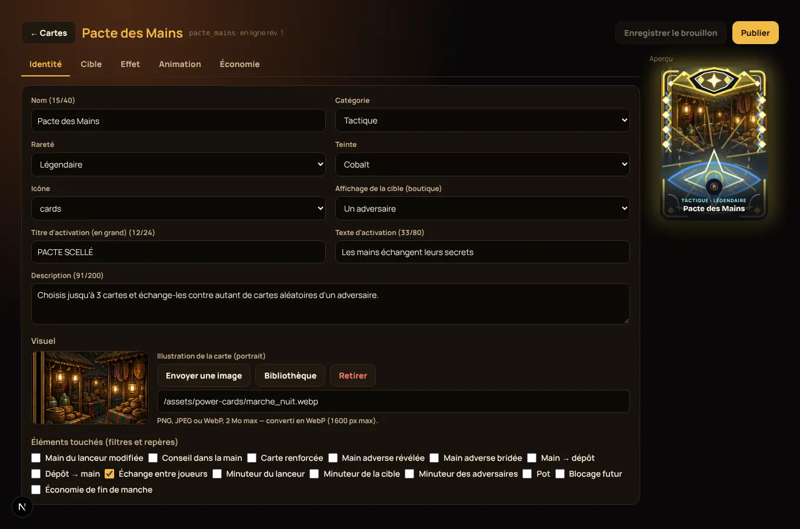
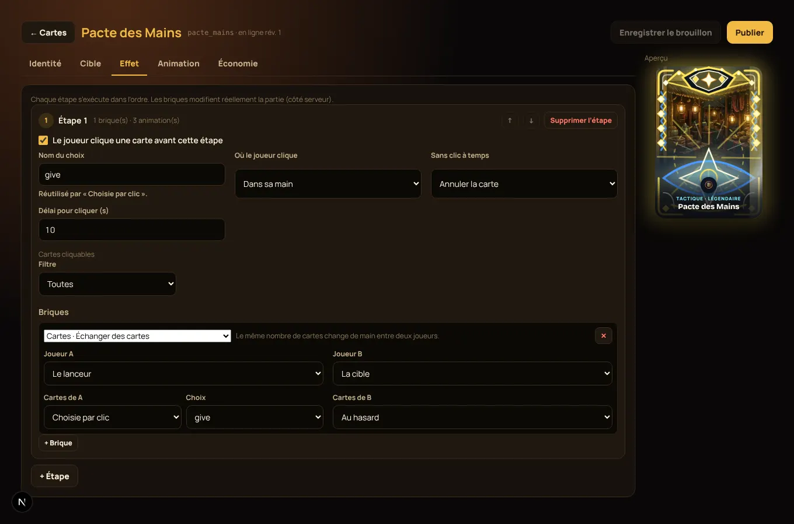
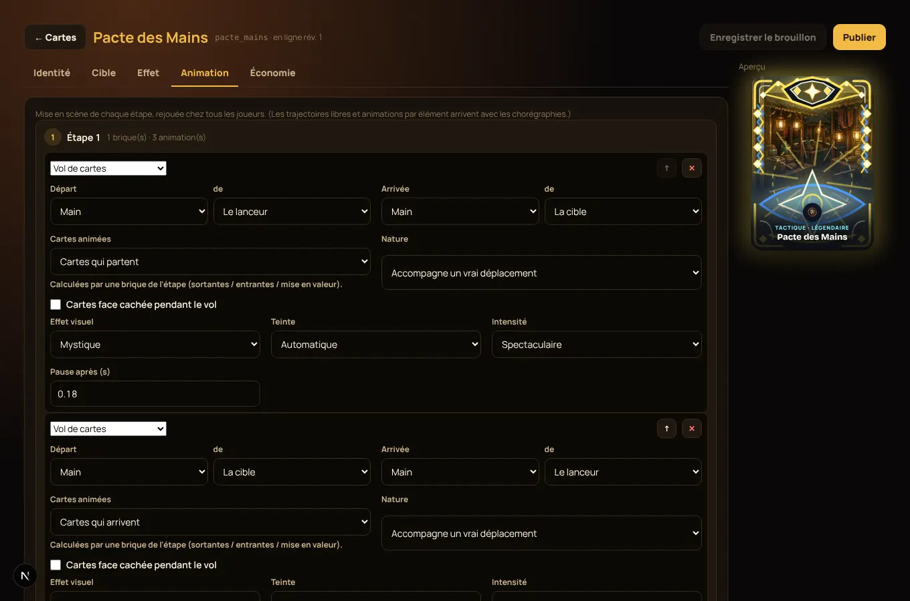
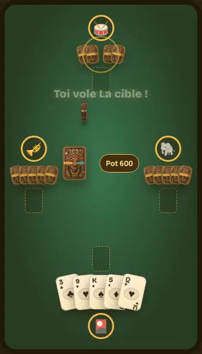
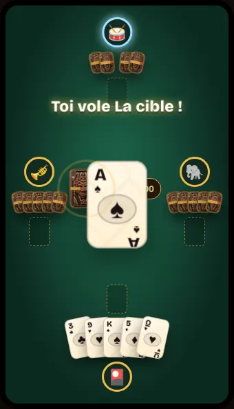
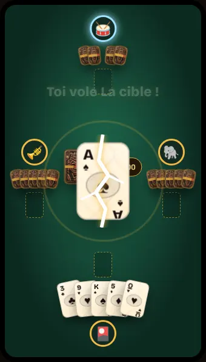
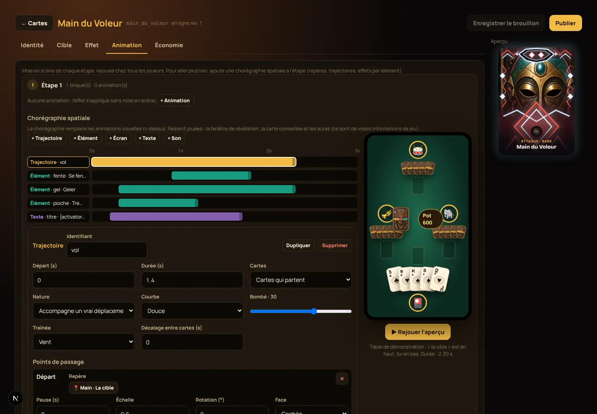
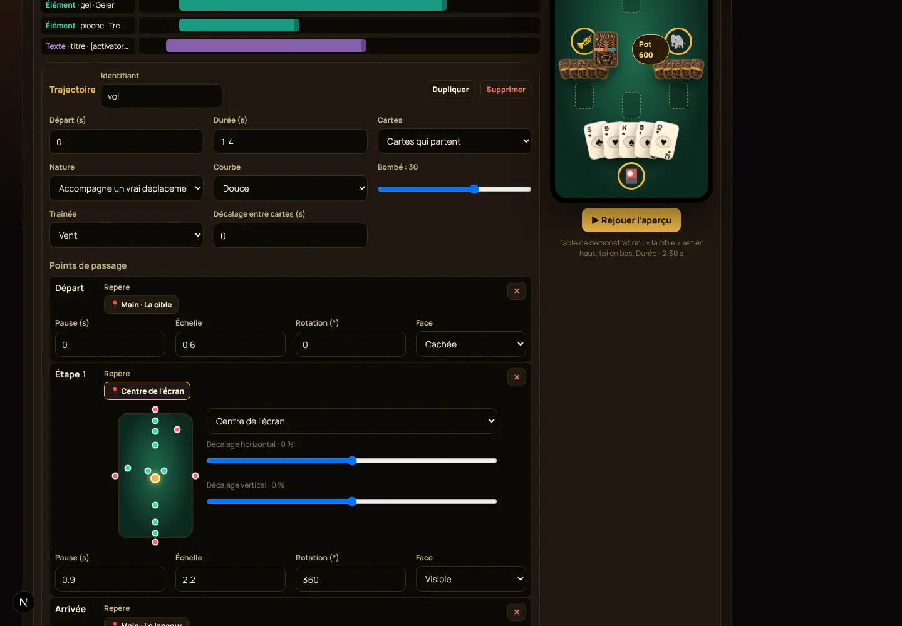

# Plan — Cartes de pouvoir pilotées par l'admin & chargeur d'assets

> Document de **plan et de suivi**, mis à jour à chaque implémentation
> (cases cochées, statut, journal en bas de page).
>
> Branche : `ccr-d50eb567-ocrmnv`

## Suivi global

| Phase | Contenu | Statut |
| --- | --- | --- |
| A | Fondations : registre dynamique des cartes, validation des scripts, migration des 21 cartes | ✅ Terminé |
| B | Console admin des cartes : identité, cible, effet (briques), économie, publication | ✅ Terminé |
| C | **Chorégraphies spatiales** : repères, trajectoires de cartes, animations propres à chaque élément, ligne de temps | ✅ Terminé (à valider en jeu réel) |
| D | Sons des cartes : upload, bibliothèque, lecture en jeu (pistes de la ligne de temps) | ✅ Terminé |
| E | Chargeur d'assets : manifeste, préchargement, écran de chargement | ✅ Terminé |
| F | Bac à sable (aperçu jouable), sécurité en partie, tests de bout en bout | ✅ Terminé |
| G | **Atelier d'animations** : modèles réutilisables édités visuellement, pour les pouvoirs **et** tout le jeu ; suivi dans [`atelier-animations-suivi.md`](atelier-animations-suivi.md) | 🟡 Prototype, G1 (modèle), G2 (lecteur) et G3 (atelier admin) terminés ; G4 et G5 à faire |

Légende : ⬜ à faire · 🟡 en cours · ✅ terminé · ⛔ bloqué

---

## Décisions validées

| Sujet | Décision |
| --- | --- |
| Définir l'effet d'une carte | **Éditeur de briques** : l'admin assemble les briques que le moteur connaît déjà (voir l'inventaire ci-dessous) et l'animation de chaque étape. Un effet vraiment inédit = une nouvelle brique ajoutée par un dev, puis réutilisable par l'admin. |
| Son | **Upload + bibliothèque** : fichier envoyé (≤ 500 Ko) ou son déjà envoyé, ou son de synthèse du jeu ; volume réglable, écoute dans l'admin. |
| 21 cartes actuelles | **Migrées en base et éditables**. Le code reste un filet de secours si la base est vide. |
| Chargeur | **Hybride** : préchargement discret en approche d'un écran ; écran de chargement (progression + astuces) seulement si l'indispensable n'est pas prêt, avec un délai maximum. |

| Cible | « Sur quelle langue ça va attaquer » = **la cible** (confirmé). |
| Animations | Aller au-delà des cues prédéfinis : **repères de déplacement** (main, centre de l'écran, dépôt, pioche, minuteur, pot…), **trajectoires** de cartes, et une **animation propre à chaque élément** (carte, main, dépôt, pioche, minuteur…), le tout sur une **ligne de temps** (phase C). |
| Carte archivée *(décidé)* | Retirée de la boutique et des livres ; les joueurs qui la possèdent la **gardent et peuvent encore la jouer** (rien de payé n'est perdu). L'**interrupteur d'urgence** (phase F) est distinct : il bloque l'activation pour tous. |
| Langues *(décidé)* | Textes en français pour l'instant ; le modèle prévoit un champ `translations` facultatif (anglais, duala) pour plus tard, non édité dans ce plan. |
| Portée des animations *(décidé, phase G)* | **Tout le jeu** : la même bibliothèque anime la donne, les cartes jouées, le pli, la pioche, la défausse **et** les pouvoirs. Bascule par étapes, la synchro en ligne restant intacte. |
| Atelier ↔ chorégraphies *(décidé, phase G)* | **Modèles réutilisables** : une animation de l'atelier est un modèle nommé ; la chorégraphie d'une carte se compose en déposant des modèles sur sa ligne de temps, avec des réglages surchargeables. Les chorégraphies existantes continuent de marcher. |
| Stockage des modèles *(décidé, phase G)* | **Admin, versionnés et publiés** comme les cartes : appliqués à tous les joueurs sans redéployer. |
| Styles des joueurs *(décidé, phase G)* | **Prévus dans le modèle** : un cosmétique pourra surcharger certains réglages visuels d'un modèle (traînée, impact, teinte). La boutique viendra plus tard. |

---

## Ce qui existe déjà (et rend le projet faisable)

Le comportement des cartes est **déjà déclaratif** (`config/powers/*.ts`) :
chaque carte = `def` (données boutique) + `script` (ciblage, conditions,
étapes `ops` + `anim`), interprété par un moteur générique
(`engine/power/`) utilisé à la fois en local et sur le serveur. Les
animations sont des **cues** génériques rejoués par chaque client
(`PowerFxOrchestrator`). Rendre les cartes éditables revient donc à :
**stocker ces mêmes données en base**, les **valider**, et **remplacer la
liste figée** du code par un registre chargé dynamiquement.

### Inventaire des briques disponibles (moteur actuel)

| Famille | Briques (`ops`) |
| --- | --- |
| Cartes | `moveCards` (prendre / donner / défausser / piocher, avec sélecteurs : plus faible, plus forte, par couleur, par valeur, haut de pioche, meilleure légale, **carte choisie par clic**), `exchangeCards`, `highlightCard` |
| Information | `revealHand` (durée) |
| Restrictions | `blockNextLegalCard`, `restrictNextPlay` |
| Temps | `timerFreeze`, `timerDelta` (± secondes) |
| Valeur | `boostNextCard` (bonus de valeur, couleur imposée) |
| Pot / économie | `potBonus`, `potMultiplier`, `refundOnLoss`, `preventDoublePenalty` |
| Défense | `grantShield` (bloque : ciblage, révélation, restriction, attaque du temps) |

| Animations (`anim`, cues) | `flyCards`, `revealOverlay`, `highlightHandCard`, `timerFx`, `deckPulse`, `potFlash`, `avatarAura` (bouclier, masque, totem, chance), `toast` + **préréglage d'effets** (`mystic`, `wind`, `frost`, `time`, `goldRain`, `shield`, `revealMist`, `lock`, `boost`) et intensité |

Ciblage : aucun, soi, **un adversaire** (choisi par le joueur ou au
hasard), **plusieurs / tous**. Conditions : pioche non vide, être en tête
du pli…

### Ce qui bloque aujourd'hui
- `PowerCardId` est une **union figée** dans `types/game.ts`, utilisée par
  ~20 fichiers (boutique, collection, table, profil, serveur…).
- Les visuels sont des fichiers du dépôt (`/assets/power-cards/*.webp`).
- Les sons sont **synthétisés** (GXE `playChime`) : il n'existe aucun lecteur
  de fichiers audio ni préchargement audio.
- Le préchargement actuel se limite à quelques chunks de scènes et une image
  (`lib/idlePreload.ts`) ; le service worker ne met pas en cache les images
  du VPS (`/uploads`, autre domaine).

---

## Phase A — Fondations

### Données
- `power_cards/{id}` : `{ def, script, sound?, published, archived?, revision, updatedAt }`
- `power_card_versions/{id}_v{rev}` : révisions publiées, **immuables**
- Index public `power_catalog/current` : `{ revision, cards: [...] }` (une
  seule lecture côté client, mis à jour à chaque publication)

### Tâches
- [x] `PowerCardId` → `string` + type `PowerCardRecord` ; registre
      `getPowerCard(id)` / `listPowerCards()` alimenté par la base, repli sur
      `config/powers` si vide
- [x] Adapter les ~20 fichiers qui lisent `POWER_CARDS` / `POWER_CARDS_BY_ID`
      (boutique, collection, table, profil, barres d'équipement, serveur)
- [x] `domain/powerScript.ts` : `normalizePowerCard()` + `validatePowerCard()`
      (même principe que `validateEventVersion` : erreurs par chemin de champ),
      **bornes de sécurité** (durées, nombre de cartes déplacées, montants,
      multiplicateurs, nombre d'étapes) + tests
- [x] Serveur : registre en mémoire rechargé à chaque publication (pas une
      lecture par coup joué) ; `usePowerCard`, `equipPowerCards`, boosters
      utilisent le registre
- [x] **Instantané par partie** : les scripts des cartes équipées sont
      copiés dans l'état moteur du match au démarrage → modifier une carte
      n'affecte jamais une partie en cours
- [x] Commande `seedPowerCards` : copie les 21 cartes du code en base
      (idempotente) ; outil « Outils » de l'admin
- [x] Rareté : correspondance carte de pouvoir (commune → légendaire) ↔
      rareté des livres (village → ancêtre) documentée et centralisée

**Critère de fin** : le jeu fonctionne à l'identique avec les 21 cartes lues
en base ; base vide → repli sur le code.

### Implémenté

| Élément | Où | Détail |
| --- | --- | --- |
| Identifiant libre | `types/game.ts` | `PowerCardId = string` ; `PowerCardDef` gagne `boosterTier`, `inShop`, `inBoosters`, `archived`, `disabled`, `translations` (facultatifs) |
| Registre dynamique | `config/powers/registry.ts` | Démarre avec les cartes du code (`CODE_POWER_MODULES`), remplacé par `setPowerCatalog(cartes, révision)` ; `getPowerModule`, `listPowerModules`, `powerScriptOf`, `powerRequiresTarget`, `boosterTierOf`, `isInBoosters`, abonnement aux changements. Catalogue vide → repli sur le code |
| Vue boutique | `config/powerCards.ts` | `POWER_CARDS` (proposées : ni test hors dev, ni archivées) et `POWER_CARDS_BY_ID` (toutes, archivées comprises) **mis à jour en place** : les ~20 fichiers existants n'ont pas changé |
| Validation | `engine/power/validate.ts` (+ `tests/power-card-validation.test.ts`) | Fiche (textes, catégorie, rareté, visuel, prix…) et script (ciblage, conditions, briques, sélecteurs, choix, animations) ; **bornes** : 6 étapes, 8 briques et 10 animations par étape, durées ≤ 15 s, minuteur ± 30 s, multiplicateur de pot ≤ 5, bonus ≤ 100 000, 3 cibles… ; un « choix » référencé doit avoir été demandé. Les 21 cartes du code passent |
| Données | `power_cards/{id}`, `power_card_versions/{id}_v{rev}`, `power_catalog/current` | Catalogue publié complet en un document (`revision`, `cards`) lisible par tous ; fiches et versions réservées aux admins (`authz.ts`, `firestore.rules`) |
| Serveur | `functions/src/powerCatalog.ts` | `ensurePowerCatalogFresh()` : relit la révision au plus toutes les 30 s ; appelée par `startMatch`, `usePowerCard`, `equipPowerCards`, livres, grille du jour |
| Partie figée | `matchCommands.ts`, `powerCommands.ts` | `startMatch` copie les scripts des cartes équipées dans l'état moteur (`powerScripts`) ; `usePowerCard` les utilise en priorité |
| Interrupteur d'urgence | `usePowerCard` | `def.disabled` → `POWER_CARD_DISABLED` |
| Livres | `economyCommands.ts` | L'ancienne table en dur est remplacée par `boosterCardPool(palier)` calculé depuis le catalogue ; les 21 cartes gardent **exactement** leurs paliers (Cauris Chanceux et Sceau d'Entrave restent hors livres) |
| Commandes admin | `functions/src/powerCardAdminCommands.ts` | `seedPowerCards` (idempotente, n'écrase rien), `listAdminPowerCards`, `setPowerCardStatus { archived, disabled }`, `rebuildPowerCatalog` |
| Client | `hooks/usePowerCatalog.ts`, `NjamboApp.tsx` | Écoute `power_catalog/current`, ignore les cartes invalides, re-rendu à chaque publication |
| Admin | Outils | Bouton « Migrer les cartes de pouvoir en base » |

**Limite connue** : l'*animation* d'une activation lit la carte dans le
catalogue courant du client. Si l'admin modifie l'animation d'une carte
pendant une partie, les joueurs voient la nouvelle animation, mais l'*effet*
reste celui du lancement. Cela sera traité par les chorégraphies (phase C).

Test `server/scripts/smoke-power-catalog.cjs` (Postgres jetable) — 18/18 :
repli sur le code, migration réservée aux admins et idempotente, catalogue
publié, registre serveur alimenté, 4 paliers de livres identiques à
l'ancienne table, scripts figés dans la partie malgré une modification,
archivage (hors livres, toujours équipable), interrupteur d'urgence,
refus d'une carte inconnue. Les 8 autres suites passent toujours
(20, 11, 13, 15, 16, 10, 14, 15).

**Pour la mise en production** : après déploiement, cliquer une fois sur
« Migrer les cartes de pouvoir en base » (Admin → Outils).

---

## Phase B — Console admin des cartes

Section **Cartes de pouvoir** (liste filtrable par catégorie / rareté /
statut, dupliquer, archiver) et éditeur en onglets, avec validation en
direct comme pour les événements :

| Onglet | Contenu |
| --- | --- |
| **Identité** | Nom, description, titre et texte d'activation, catégorie (offensive, défense, score, **tactique**, perturbation, économie), **rareté**, icône et teinte, **visuel** (upload WebP) |
| **Cible** | Aucune / soi / un adversaire (choisi par le joueur ou au hasard) / plusieurs / tous ; conditions d'activation |
| **Effet** | Constructeur d'**étapes** : chaque étape = une brique choisie dans la liste + ses réglages (formulaire adapté), et éventuellement un **clic du joueur** (choisir une carte dans sa main, un dépôt, une main révélée) |
| **Animation** | Chorégraphie de chaque étape (phase C) : ligne de temps, repères, trajectoires, animations des éléments ; en phase B, édition des cues existants en attendant |
| **Son** | Voir phase C |
| **Économie** | Prix en cauris / Nkap, présent en boutique, dans les livres (boosters), actif / test seulement |
| **Aperçu** | Voir phase E |

- [x] Commandes admin : `listPowerCards`, `getPowerCard`, `savePowerCardDraft`,
      `publishPowerCard`, `duplicatePowerCard`, `archivePowerCard` (audit)
- [x] Composants : `PowerScriptEditor` (étapes + briques), `AnimCueEditor`,
      `CardSelectorField`, `TargetField`, réutilisation de `ImageField`
- [x] Rendu de la carte telle qu'elle apparaîtra (motif de catégorie, rareté, visuel)
- [x] Archiver une carte : retirée de la boutique et des livres ; les joueurs
      qui la possèdent la gardent et peuvent encore la jouer

**Critère de fin** : un admin crée une carte inédite (combinaison de
briques) sans toucher au code, et elle se joue en partie.

### Implémenté

**Serveur** (`functions/src/powerCardAdminCommands.ts`) :
`getAdminPowerCard`, `savePowerCardDraft` (brouillon même invalide, crée la
fiche si besoin, renvoie les erreurs), `publishPowerCard` (refus
`POWER_CARD_INVALID` avec le détail ; nouvelle révision immuable ; le statut
archivée / coupée n'est **jamais** écrasé par une publication ; catalogue
republié), `duplicatePowerCard`, `discardPowerCardDraft` (supprime la fiche
si jamais publiée). Toutes auditées. Upload d'images : nouveau type `power`.

**Admin** (`components/admin/PowerCardsAdmin.tsx`, `PowerScriptEditor.tsx`, `powerLabels.ts`) :
- **Catalogue** : grille des cartes (rendu réel `PowerCardView`), pastilles
  (jamais publiée, brouillon, archivée, coupée, test, erreurs), filtres par
  catégorie / statut, Modifier, Dupliquer, Archiver / Désarchiver,
  **Couper / Réactiver** (avec confirmation) ; écran de première mise en
  route qui propose la migration des 21 cartes.
- **Éditeur** avec aperçu de la carte en direct et validation en direct
  (pastille d'erreurs par onglet, liste « à corriger », Publier bloqué) :
  - *Identité* : nom, catégorie (dont **Tactique**), rareté, teinte, icône,
    affichage de cible, titre et texte d'activation, description, visuel
    (upload / bibliothèque), éléments touchés ;
  - *Cible* : qui est visé (aucun, un joueur, plusieurs, tous les
    adversaires, un adversaire au hasard), qui choisit, nombre max, se viser
    soi-même, conditions d'activation ;
  - *Effet* : étapes ordonnables, « le joueur clique une carte » (où, de
    qui, filtre, délai, que faire sans clic), **14 briques** avec formulaire
    adapté (zones, joueurs, sélecteurs de cartes y compris « choisie par
    clic », durées, secondes, montants, multiplicateur, bouclier…) ;
  - *Animation* : animations de chaque étape (vol de cartes, révélation,
    surbrillance, minuteur, pioche, pot, aura, message) + effet visuel,
    teinte, intensité, pause ;
  - *Économie* : prix cauris / Nkap, palier de livre, vendue en boutique,
    dans les livres, carte de test.

**Jeu** : la collection affiche aussi les cartes **archivées que le joueur
possède** (toujours jouables) et se met à jour à chaque publication.

Test `server/scripts/smoke-power-editor.cjs` (Postgres jetable) — 13/13 :
brouillon invalide enregistré mais publication refusée, carte absente du
jeu avant publication, **carte inédite** publiée (catalogue 22 cartes,
livres « Chef »), révision immuable, républication qui conserve
« archivée », puis **en vraie partie** : carte équipée, activée, +8 s au
minuteur, carte consommée ; duplication et abandon de brouillon.

---

## Phase C — Chorégraphies spatiales

### Idée
Aujourd'hui une étape de carte joue des **cues** figés (« vol de cartes »,
« révélation »…). On ajoute, à côté, une **chorégraphie** : une ligne de
temps de **pistes** qui disent *quoi bouge, d'où, par où, vers où, quand,
et comment chaque élément réagit*. Les cues existants deviennent des
**modèles** de chorégraphie (rien n'est perdu, les 21 cartes continuent de
marcher).

### Repères (points d'ancrage)
Calculés à chaque lecture à partir des zones déjà enregistrées par la table
(`components/table/zones/ZoneRegistry.tsx`), donc justes sur mobile comme
sur ordinateur, en portrait comme en paysage :

| Repère | Exemples |
| --- | --- |
| Zones de joueur | `main:lanceur`, `main:cible`, `main:tous`, `dépôt:lanceur`, `dépôt:cible`, `minuteur:cible`, `avatar:lanceur` |
| Zones communes | `pioche`, `pot`, `révélation`, `centre de l'écran`, `centre de la table` |
| Bords | `hors-écran haut / bas / gauche / droite` |
| Précision | carte précise (« la carte choisie », « la plus forte »…), **décalage** (x, y en % de la zone), au-dessus / au-dessous |

### Pistes de la ligne de temps
| Piste | Réglages |
| --- | --- |
| **Trajectoire de carte** | Quelles cartes (celles calculées par le moteur : données, prises, choisies, piochées…), **points de passage** successifs (repère + décalage + pause), durée, courbe (linéaire, douce, rebond, élastique), arc, rotation, échelle, **retournement** (face visible / cachée / au milieu du trajet), traînée d'effet |
| **Animation d'élément** | Élément ciblé (une **carte**, une **main**, un **dépôt**, la **pioche**, le **minuteur**, un **avatar**, le **pot**, l'écran) + effet de sa bibliothèque propre (ci-dessous), départ, durée, intensité, couleur |
| **Effet d'écran** | Flash, tremblement, assombrissement, particules (préréglages existants : mystique, vent, givre, temps, pluie d'or…) |
| **Texte** | Message flottant ancré sur un repère (« VISION ! », « −3 s ») |
| **Son** | Son (phase D) déclenché à un instant donné |

Les pistes ont un **départ** et une **durée** (en ms) : elles peuvent
s'enchaîner ou se superposer. Une piste peut dépendre de la précédente
(« au moment où la carte arrive »).

### Bibliothèque d'animations propres à chaque élément
| Élément | Animations |
| --- | --- |
| Carte | soulever, pulser, briller, trembler, se retourner, se fendre, se dissoudre, s'enflammer, geler, rétrécir / grandir |
| Main | s'ouvrir en éventail, se resserrer, trembler, briller, se voiler (cachée), s'illuminer carte par carte |
| Dépôt | pulser, aspirer (les cartes rentrent), éjecter, s'illuminer, se verrouiller (sceau) |
| Pioche (distribution) | pulser, se mélanger, cracher une carte, trembler, briller |
| Minuteur | geler, accélérer (tourne vite), reculer, se fissurer, clignoter, changer de couleur, afficher ± secondes |
| Avatar | aura (bouclier, masque, totem, chance), secousse, halo de couleur, rebond |
| Pot | éclat, pluie de pièces, grossir, afficher un montant |

Chaque zone de la table expose une fonction générique
`play(effet, réglages)` en plus de ses fonctions actuelles ; un effet
inconnu d'une ancienne version du jeu est simplement ignoré.

### Tâches
- [x] `engine/power/choreography.ts` : types (`Choreography`, pistes,
      repères, points de passage, effets par élément) + validation et bornes
      (durée totale ≤ 6 s, nombre de pistes, points de passage) + tests
- [x] Conversion des cues existants en chorégraphies-modèles (les 21 cartes
      gardent exactement leur rendu)
- [x] `ZoneRegistry` : résolution des repères (rect + décalage) ;
      `play(effet)` sur chaque zone (main, dépôt, pioche, minuteur/avatar,
      pot, révélation) et sur les cartes en vol
- [x] Lecteur de chorégraphie (GSAP déjà chargé) : trajectoires à points
      de passage, courbes, retournement, synchronisation entre pistes ;
      repli instantané si « Animations » est désactivé dans les Options ou
      en mode performance
- [x] Admin, onglet **Animation** : éditeur de **ligne de temps** (pistes
      en barres déplaçables), formulaire de chaque piste, choix des repères
      sur un **schéma de la table** cliquable, modèles de départ, bouton
      « Rejouer » dans l'aperçu
- [x] Le moteur reste l'autorité : la chorégraphie ne fait qu'**animer** les
      cartes réellement déplacées par les briques (`resolved:*`) ; une
      trajectoire ne peut pas inventer un déplacement de carte

**Critère de fin** : un admin construit une animation où, par exemple, la
carte quitte la main de la cible, monte au centre de l'écran en se
retournant, s'y fend en deux, pendant que le minuteur de la cible gèle et
que la pioche tremble — sans écrire de code.

### C1 — Modèle (implémenté, `engine/power/choreography.ts`)

- `PowerStep.choreo?: Choreography` (`{ tracks }`), validée avec la carte.
- **Repères** : zone (`main` / `dépôt` / `minuteur` d'un joueur, `pioche`,
  `pot`, `révélation`), écran (`centre`, `centre de la table`, `haut`,
  `bas`, `gauche`, `droite`, `hors-écran` ×4), ou la carte elle-même ;
  décalage `dx` / `dy` en % de l'écran.
- **Pistes** (départ + durée en ms, superposables, 8 s au total, 20 pistes) :
  `cardPath` (cartes sortantes / entrantes / mise en valeur ou **fantôme**
  décorative, réelle ou visuelle, 2 à 6 points de passage avec pause,
  échelle, rotation, face visible / cachée, courbe, bombé, décalage entre
  cartes, traînée), `element` (effet propre à l'élément, intensité 1-3,
  teinte, texte), `screen` (flash, tremblement, assombrissement,
  particules), `text`, `sound` (phase D).
- **Bibliothèque par élément** : carte (soulever, pulser, briller, trembler,
  se retourner, se fendre, se dissoudre, s'enflammer, geler, rétrécir,
  grandir) · main (s'ouvrir, se resserrer, trembler, briller, se voiler,
  vague) · dépôt (pulser, aspirer, éjecter, briller, sceller) · pioche
  (pulser, mélanger, cracher, trembler, briller) · minuteur (geler,
  accélérer, reculer, se fissurer, clignoter, teinter, ± secondes) · avatar
  (4 auras, trembler, halo, rebond) · pot (éclat, pluie de pièces, grossir,
  montant).
- **Règle de sécurité** : une chorégraphie remplace la mise en scène
  *visuelle* ; les cues **fonctionnels** (`revealOverlay` = vraie main
  révélée, `highlightHandCard` = vraie carte conseillée, `avatarAura` =
  protection active) restent toujours joués.
- `choreographyFromCues()` : convertit les cues visuels d'une étape en
  chorégraphie de départ (bouton « Convertir » de l'éditeur) ; testé sur les
  21 cartes.
- Tests : `tests/choreography.test.ts` (5) — dont l'exemple du critère de fin.

### C2 — Lecteur (implémenté, `components/power/choreo/`)

| Fichier | Rôle |
| --- | --- |
| `ChoreoLayer.tsx` | Calque fixe au-dessus de la table : cartes volantes rendues avec le **vrai** `PlayCard` (recto + verso pour les retournements 3D), conteneur des textes et effets |
| `playChoreography.ts` | Lecteur : repères calculés depuis les zones réelles (et une « fenêtre de référence » pour les repères d'écran), trajectoires multi-points (durée répartie selon les distances, pauses, bombé, échelle, rotation, retournement, courbes, décalage entre cartes, traînée), effets d'éléments (Web Animations sur l'élément lui-même + calques : fissure, givre, flammes, dissolution, sceau, halo ; effets métier délégués aux zones : gel et ± secondes du minuteur, auras, montant du pot), effets d'écran, textes (avec `{activator}` / `{target}`), pistes son (phase D). Animations coupées → pistes sautées (les effets réels du jeu n'en dépendent jamais) |
| `ChoreoDemoStage.tsx` | **Table de démonstration** (cadre téléphone) : mains, dépôts, avatars/minuteurs, pioche, pot, enregistrés dans son propre registre ; joue la chorégraphie avec le même lecteur que le jeu |

Zones : chaque handle expose `getElement()` (main, dépôt, avatar/minuteur,
pioche, pot, révélation).

Jeu (`PowerFxOrchestrator.tsx`) : une étape **avec** `choreo` joue ses cues
fonctionnels puis la chorégraphie ; les pistes « déplacement réel »
masquent les cartes source et libèrent l'état à la fin, exactement comme
les vols actuels. Une étape **sans** `choreo` est jouée comme avant (les 21
cartes ne changent pas).

Vérifié dans Chromium sur la table de démonstration avec l'exemple du
critère de fin :

| 250 ms | 700 ms | 1,3 s |
| --- | --- | --- |
|  |  |  |

### C3 — Éditeur (implémenté, `components/admin/ChoreographyEditor.tsx`)

Dans l'onglet **Animation** de chaque carte, chaque étape propose
« Créer depuis les animations de l'étape » (conversion) ou « Partir de
zéro », puis :

- **Ligne de temps** (0 à 8 s, graduée) : une barre par piste, colorée par
  type (trajectoire, élément, écran, texte, son) ; **glisser** la barre
  change le départ, **étirer** son bord droit change la durée (pas de
  50 ms) ; pistes en erreur entourées de rouge ; ajout rapide
  « + Trajectoire / Élément / Écran / Texte / Son » ; dupliquer, supprimer,
  renommer (les références « carte en vol » suivent).
- **Formulaire de piste** : trajectoire (cartes, nature, courbe, bombé,
  traînée, décalage entre cartes, **points de passage** avec repère,
  pause, échelle, rotation, face) ; élément (élément, joueur, animation de
  sa bibliothèque, intensité, teinte, texte) ; écran ; texte ; son.
- **Repères** : bouton 📍 qui ouvre un **schéma de table cliquable**
  (mains, dépôts, minuteurs, pioche, pot, centre, bords et hors-écran) +
  liste complète + curseurs de décalage horizontal / vertical.
- **Aperçu** : la table de démonstration (collante pendant le défilement)
  rejoue la chorégraphie en cours d'édition, même non enregistrée.
- Règle rappelée dans l'éditeur : la chorégraphie remplace les animations
  visuelles ; révélation, conseil et auras restent joués.

Serveur : une chorégraphie invalide bloque la publication (détail par
chemin) ; une valide est publiée et diffusée au catalogue
(`smoke-power-editor.cjs` : 15/15).

| Ligne de temps et aperçu | Choix d'un repère |
| --- | --- |
|  |  |

**À valider en jeu réel** : créer une carte avec une chorégraphie (par ex.
vol de carte de la main de la cible vers le centre puis vers ta main),
la publier, l'activer en partie avec deux comptes et vérifier le rendu
chez le lanceur et chez la cible (portrait et paysage).

---

## Phase D — Sons des cartes

- [x] Upload audio : `POST /admin/upload-audio` (route dédiée) — MP3 / OGG / M4A / WAV,
      ≤ 500 Ko, signature vérifiée, durée ≤ 5 s ; conversion en **OGG +
      MP3** et normalisation du volume si `ffmpeg` est présent sur le VPS
      (sinon fichier gardé tel quel) ; bibliothèque `admin_uploads` (kind
      `audio`)
- [x] Champ son de la carte : fichier uploadé **ou** son de synthèse du jeu
      (préréglages GXE existants) ; volume 0-100 % ; bouton écouter
- [x] Lecteur audio dans le runtime GXE : décodage WebAudio, cache des sons
      décodés, respect du réglage « Effets sonores », pas de lecture avant
      le premier geste (déverrouillage audio déjà géré par GXE)
- [x] Lecture à l'activation, ou à un instant précis via une **piste son** de la chorégraphie (phase C)
- [x] `docs/deploiement.md` : installer `ffmpeg` sur le VPS (facultatif)

**Critère de fin** : un son uploadé dans l'admin est joué chez tous les
joueurs quand la carte est activée, sans latence perceptible.

### Implémenté

| Élément | Où | Détail |
| --- | --- | --- |
| Upload | `server/src/audioUploads.ts` | `POST /admin/upload-audio` (admin) : MP3 / OGG / WAV / M4A, 500 Ko max, **signature binaire** vérifiée, durée lue par `ffprobe` (source ≤ 60 s), conversion `ffmpeg` en **MP3 mono 44,1 kHz 96 kb/s, volume normalisé (loudnorm), coupé à 5 s avec fondu** ; sans ffmpeg, fichier gardé tel quel ; bibliothèque `admin_uploads` (kind `audio`) ; servi par `/uploads` (cache immuable) |
| Lecture | `lib/gxe/react.tsx` | `preloadAudioSample` (téléchargement + décodage WebAudio, cache), `playAudioSample` (bus « effets sonores » : coupé avec eux), `playChimeNow` (synthèse hors React) |
| Sons de cartes | `lib/powerSounds.ts` | Référence `preset:<nom>` (synthèse, aucun fichier) ou URL ; **11 préréglages** : pouvoir, tambour, éclair, vent, givre, gong, pièces, magie, alarme, sceau, souffle du temps ; `playPowerSound`, `preloadPowerSound` (pour le chargeur) |
| Carte | `PowerCardDef.sound { ref, volume }` | Validé (`isSoundRef` : préréglage connu ou fichier audio) ; un test vérifie que la liste validée = la bibliothèque |
| Jeu | `PowerFxOrchestrator.tsx` | Son d'activation de la carte (sinon son par défaut) ; pistes **son** des chorégraphies jouées à l'instant prévu ; table de démonstration aussi |
| Admin | `components/admin/SoundField.tsx` | Préréglage, ▶ Écouter, envoyer un son, bibliothèque (écoute + choisir), volume ; onglet Identité (« Son d'activation ») et pistes son de la ligne de temps |

Test `server/scripts/smoke-audio-upload.cjs` (ffmpeg + Postgres jetable) —
9/9 : non-admin refusé, type non audio refusé, faux MP3 refusé, > 500 Ko
refusé, WAV de 8 s converti en MP3 coupé à 5 s (≈ 5 040 ms), cache
immuable, MP3 mono 44,1 kHz vérifié par ffprobe, bibliothèque.

**Déploiement** : `sudo apt install -y ffmpeg` sur le VPS (ajouté à
`docs/deploiement.md`).

---

## Phase E — Chargeur d'assets

### Principe (hybride)
1. **Manifeste** : chaque écran déclare ses assets **indispensables**
   (bloquants) et **secondaires** (chargés après affichage).
2. **Préchargement discret** dès qu'on s'approche d'un écran (menu → choix
   du mode → table ; liste → détail d'événement ; profil → collection), une
   ressource à la fois, au repos du navigateur.
3. **Écran de chargement** (`LoadingGate`) seulement si l'indispensable
   n'est pas prêt à l'arrivée : barre de progression, astuce de jeu, fond
   aux couleurs de l'écran ; **délai maximum (≈ 6 s)** puis affichage quand
   même (les assets manquants arrivent ensuite).

### Ce qui est chargé à l'entrée de la table
Tapis et fond, dos de carte (y compris celui équipé), faces des cartes,
avatars et **cosmétiques de tous les participants** (cadres, badges),
**visuels + sons des cartes de pouvoir équipées par tous les joueurs**,
textures des effets (particules), polices.

### Tâches
- [x] `lib/assets/AssetLoader.ts` : images (`decode()`), audio (fetch +
      décodage WebAudio), polices ; priorités, file d'attente, dédoublonnage,
      suivi de progression, nouvelle tentative, cache mémoire
- [x] `lib/assets/manifests.ts` : manifestes par écran (table, boutique,
      collection, événements, détail d'événement, saison) ; manifeste de la
      table calculé à partir des participants et des pouvoirs équipés
- [x] `components/ui/LoadingGate.tsx` : écran de chargement + astuces
- [x] Intégration : entrée à la table (avant la donne), boutique,
      collection de pouvoirs, liste des événements
- [x] Préchargement d'approche branché sur la navigation (`scenePreload`)
- [x] Service worker : mise en cache des images et sons du VPS (`/uploads`,
      noms immuables) en plus de ceux du front
- [x] Mesures : temps d'attente réel, taux d'affichage de l'écran de
      chargement (`performanceMetrics`)

**Critère de fin** : en 3G lente, la table s'ouvre avec tous ses visuels et
sons prêts (ou au pire après l'écran de chargement), sans image qui
apparaît en retard pendant la donne.

### Implémenté
- **`lib/assets/AssetLoader.ts`** : une seule file pour tout le jeu.
  - Images : téléchargées **puis décodées** (`decode()`), donc aucune image
    n'apparaît en retard pendant la donne. Les images décodées restent
    référencées en mémoire (240 au plus).
  - Sons : téléchargés et décodés en WebAudio. Les sons de synthèse
    (`preset:`) n'ont rien à charger.
  - 4 chargements en parallèle. Ce qui est indispensable passe devant le
    préchargement, et un préchargement en attente est promu dès qu'un écran
    l'attend.
  - Chaque asset n'est chargé qu'une fois. En cas d'échec, une nouvelle
    tentative a lieu après 600 ms. Un asset en échec ne bloque jamais.
  - API : `loadAssets` (avec progression), `prefetchAssets` (au repos du
    navigateur), `isAssetReady` et `areAssetsReady`.
- **`lib/assets/manifests.ts`** :
  - **Table** : on lit dans le style calculé l'image du tapis
    (portrait / paysage / bureau), le fond et **le dos de carte équipé**,
    c'est-à-dire exactement ce que le navigateur va afficher.
  - Viennent ensuite le visuel, le son d'activation et les sons de
    chorégraphie de **mes pouvoirs équipés**. Tout cela est indispensable.
  - Sont chargés ensuite : les cosmétiques des participants, puis tout le
    catalogue de pouvoirs (ce que les adversaires peuvent jouer : leurs
    cartes restent secrètes côté client).
  - Autres écrans : boutique (livres, monnaies), collection (12 premiers
    visuels indispensables, le reste ensuite), liste des événements
    (icônes, puis vignettes) et détail d'un événement (illustration).
- **`components/ui/LoadingGate.tsx`** :
  - si tout est déjà en cache, l'écran s'ouvre immédiatement ;
  - si le chargement prend moins de 150 ms, rien ne s'affiche (pas de flash) ;
  - sinon, un écran de chargement apparaît : éventail de dos de carte,
    barre de progression, compteur et astuce ;
  - après le délai maximum, l'écran s'ouvre quand même : 6 s pour une table
    contre l'IA, 3 s en salle ou en file d'événement (pour ne pas retarder le
    match serveur), 4 s pour les autres écrans.
- **Intégration** (`NjamboApp`) :
  - la table n'est montée qu'une fois la porte ouverte, donc la donne
    commence avec tous ses visuels ;
  - la boutique, la collection et la liste des événements passent aussi par
    la porte.
- **Préchargement d'approche** :
  - choix du mode, réglage IA, en ligne, amis, lobby ou détail d'événement
    préchargent la table ;
  - profil → collection ; menu ou collection → boutique ;
  - `preloadScene` (survol des boutons) précharge aussi les assets de
    l'écran visé ;
  - la liste des événements précharge les vignettes et les illustrations en
    plein format.
- **Service worker** : cache `njambo-uploads-v1` pour 160 images et sons
  `/uploads/…` du VPS au maximum, servis depuis le cache en priorité même
  quand ils viennent d'une autre origine. Une réponse opaque n'est jamais
  servie à une requête CORS.
- **CORS sur `/uploads`** :
  - en-têtes `Access-Control-Allow-Origin: *` et
    `Cross-Origin-Resource-Policy: cross-origin` ;
  - déjà fait côté Express ; côté Nginx, voir `docs/deploiement.md` ;
  - sans ces en-têtes, les sons uploadés ne peuvent pas être lus en WebAudio
    depuis le front Vercel.
- **Mesures** : marques `njambo:gate:<écran>` et `getGateStats()`. Par écran,
  on obtient les entrées, le taux d'affichage de l'écran de chargement, les
  délais dépassés et l'attente moyenne et maximale.
- **Tests** : `tests/asset-loader.test.ts` (4 tests : dédoublonnage,
  concurrence et progression, priorité, nouvelle tentative).
- **Vérification visuelle** (`docs/captures/chargeur/`) :
  - avec un réseau ralenti, l'écran de chargement s'affiche avec sa
    progression ;
  - en 2e visite avec le cache chaud, aucun écran n'apparaît ;
  - avec une image bloquée, l'écran s'ouvre de force au délai maximum ;
  - la table s'ouvre ensuite normalement ;
  - le mode test équipe 21 pouvoirs, soit 21 assets indispensables, contre
    3 au maximum en jeu normal.

---

## Phase F — Aperçu, sécurité, tests

- [x] **Bac à sable** dans l'admin : une mini-table locale (moteur local +
      bots) où l'on active la carte en cours d'édition, avec son animation et
      son son ; rejouer
- [x] Interrupteur d'urgence : désactiver une carte instantanément
      (refusée à l'activation, retirée de la boutique)
- [x] Tests du domaine : validation, bornes, normalisation, migration des 21
      cartes (scripts identiques)
- [x] Test d'intégration Postgres : carte créée en admin → achetée →
      équipée → activée en vraie partie ; modification pendant une partie
      (instantané respecté) ; carte archivée
- [x] Vérification visuelle (Playwright) de l'éditeur et du chargeur

### Implémenté
- **Moteur du bac à sable** (`engine/power/sandbox.ts`, pur et testé) :
  - donne reproductible à partir d'un numéro : 4 joueurs, 4 cartes en main,
    une carte déjà déposée au 1er pli, pioche, pot de 600, minuteurs à 15 s.
    Option « pli entamé » : le joueur précédent a ouvert le pli et une couleur
    est demandée ;
  - activation par **exactement le chemin du jeu** : ciblage, validation
    (mêmes messages de refus), bouclier de la cible, interprétation, puis
    application des briques par un adaptateur en mémoire ;
  - les étapes à choix prennent automatiquement les premières cartes
    admissibles ;
  - en sortie : refus / contrée / sans effet / effet, l'état avant et après,
    et un journal lisible en français (« Toi : 3♥ part au fond de la pioche,
    8♦ arrive en main »).
- **Onglet « Bac à sable »** de l'éditeur (`components/admin/PowerSandbox.tsx`) :
  - joue la carte **telle qu'elle est à l'écran**, même non enregistrée,
    sans rien envoyer au serveur ;
  - réglages : numéro de donne / nouvelle donne, cible, pli entamé,
    bouclier sur la cible ;
  - par joueur : sa main avant → après (cartes parties en rouge, arrivées en
    vert), son minuteur (delta, gel, pénalité différée) et ses restrictions ;
    en bas, le pot, la pioche et les effets ajoutés ;
  - à droite : le son d'activation, puis l'animation de chaque étape
    (chorégraphie, ou conversion des animations simples) sur la table de
    démonstration, **avec les vraies cartes déplacées**. Bouton « Rejouer
    l'animation ».
- **Interrupteur d'urgence complété** :
  - côté serveur, c'était déjà fait en A : activation refusée
    (`POWER_CARD_DISABLED`), carte retirée des livres ;
  - désormais aussi en partie locale contre l'IA : le joueur reçoit un refus
    et les bots ne jouent pas une carte coupée ;
  - à la table, une carte coupée s'affiche comme indisponible.
- **Tests du domaine** (`tests/power-sandbox.test.ts`, 7 tests) :
  - donne reproductible ;
  - les 21 cartes activées sur 3 donnes, sans erreur et sans modifier la
    table d'origine ;
  - **migration** : pour chaque carte, la version stockée en base (JSON) se
    comporte exactement comme le code (même plan, même état final) ;
  - « pli entamé » ;
  - refus sans cible ;
  - bouclier ;
  - effets réellement appliqués.
  En plus de la validation (A, 6 tests) et des chorégraphies (C, 6 tests).
- **Intégration Postgres** (`server/scripts/smoke-power-lifecycle.cjs`,
  19/19) :
  - une carte créée en admin tombe dans un livre payé 20 cauris, est
    choisie, équipée puis jouée en vraie partie ;
  - la révision 2 (+12 s) est publiée **pendant** la partie : celle-ci
    applique son instantané (+6 s exactement) ;
  - interrupteur d'urgence : activation refusée en pleine partie, carte
    retirée des livres, puis rétablie ;
  - archivage : carte absente des 4 paliers de livres mais toujours
    équipable par son possesseur, statut diffusé au catalogue.
  Les intégrations précédentes repassent : catalogue, éditeur (15/15) et
  sons (9/9).
- **Vérifications visuelles (Playwright)** :
  - éditeur et chorégraphies : `docs/captures/choregraphies/` (C) ;
  - chargeur : `docs/captures/chargeur/` (E) ;
  - bac à sable (`docs/captures/bac-a-sable/`) : Vent du Nord (échange
    main ↔ pioche, carte en vol sur la table de démonstration), Pacte des
    Mains (échange entre joueurs), Œil du Sorcier contré par un bouclier.

**Limite connue** : sur la table de démonstration, la main affichée reste
celle de la démo. Seules les cartes déplacées par l'effet sont les vraies.
L'état exact, lui, est détaillé à gauche.

---

## Phase G — Atelier d'animations (modèles réutilisables)

### Idée
Les chorégraphies (phase C) se construisent piste par piste, dans des
formulaires, et chaque carte repart de zéro. La phase G ajoute une
**bibliothèque de modèles d'animation** :
- chaque modèle est édité **visuellement** sur un schéma de la table ;
- il est **réutilisé** par les cartes de pouvoir ;
- il anime aussi **les mouvements de base du jeu** (donne, carte jouée,
  pli, pioche, défausse).

Changer le modèle « Jouer une carte » change donc le toucher de toute la
partie.

### Prototype (validé)
`docs/prototypes/atelier-animations.html`, autonome. Pour l'ouvrir, un
double-clic suffit, ou bien la configuration `atelier` de
`.claude/launch.json` (serveur statique sur le port 5310) puis
`/docs/prototypes/atelier-animations.html`.

Il reprend la vraie disposition portrait (tapis, dos de carte, 3
adversaires, pioche, pot, dépôts, avatar et bouton pouvoirs) et contient
19 modèles :
- **les 7 trajets** : piocher, jouer, retourner sur la table, ramasser,
  défausser, vers le joueur, lancer une capacité ;
- **carte** : retourner (afficher / cacher) ;
- **main** : mise en évidence, cartes qui sortent, cartes qui entrent,
  donner une carte ;
- **dépôt** : surbrillance, entrée, éjection ;
- **espace central** : ajout, retrait ;
- **partie** : la distribution.

Ce qui s'y édite visuellement :
- **Schéma** : poignées **A** (départ) et **B** (arrivée), aimantées sur
  les zones ; le **◆** courbe la trajectoire (Bézier). Les points montrent
  l'effet de la courbe de vitesse et le ↻ marque l'instant du retournement.
- **Courbe de vitesse** : courbe de Bézier à deux poignées, avec des
  préréglages (douce, freine, rebond, ressort, aspiré, éclair…).
- **Propriétés dans le temps** : échelle, retournement, rotation,
  opacité, lueur et élévation, sous forme de courbes à points.
- **Réactions de la table** : flash, onde, gerbe, surbrillance de zone,
  couronne, pulsation d'avatar, Nkap qui clignotent, pioche qui tremble,
  assombrir les autres cartes, secousse. Elles se calent « au départ » ou
  « à l'arrivée » de chaque carte et se déplacent sur la **ligne de temps**.
- **Matrice** des 81 transitions « de → vers » : une case vide crée un
  modèle à partir du plus proche.

Le prototype calcule chaque image à partir du temps (fonction pure), donc
on peut le parcourir au ralenti ou image par image. Son JSON exporté sert
de base au modèle de données.

### Modèle (`AnimMotif`)
`{ from, to, count, staggerMs, durationMs, pick, easing: [x1,y1,x2,y2],
arc: { along, perp }, lanes: { scale, flip, rotate, opacity, glow, lift },
faceMode: "lane" | "auto", trail, squash, reactions[] }`

- Les **pistes** sont des points `[temps 0–1, valeur]`.
- Une **réaction** vaut `{ type, anchor: "start" | "arrival", offsetMs,
  dur, each, zone }`.
- `from` / `to` reprennent les repères de `engine/power/choreography.ts`,
  avec en plus :
  - `hand:all` : distribution à tour de rôle ;
  - plusieurs sources (« ramasser le pli » : tous les dépôts vers le
    gagnant), à ajouter.

### Étapes
L'avancement détaillé (cases à cocher, statut de chaque étape, journal)
est tenu dans [`atelier-animations-suivi.md`](atelier-animations-suivi.md),
mis à jour à chaque avancée.

- **G1 — Modèle** : `engine/anim/motifs.ts` regroupe :
  - les types, la normalisation et la validation avec bornes : durée
    (≤ 3 s pour un mouvement de base, afin de garder le rythme de
    `gameConfig.anim`), points par piste, échelle, réactions ;
  - les 19 modèles du prototype comme modèles par défaut ;
  - un modèle « Jouer une carte » qui reproduit le vol actuel
    (`FlyingCard`) : même position, rotation et face, taille à moins de
    1 % ;
  - des tests.
- **G2 — Lecteur** : `playChoreography.ts` gagne une piste
  `{ kind: "motif", motifId, cards, overrides? }`. Le lecteur gère :
  - les pistes de propriétés, la courbe de Bézier et le bombé ;
  - la face automatique, la traînée et l'écrasement ;
  - les réactions.

  Côté zones : `HandHandle` gagne l'écartement et le resserrement de
  l'éventail ; les auras d'avatar, les Nkap et la pioche reçoivent leurs
  réactions. Le tout reste coupé par `useMotionEnabled()`. La table de
  démonstration joue les modèles.
- **G3 — Atelier dans l'admin** : une section « Animations » porte
  l'atelier du prototype en React :
  - côté serveur : brouillon, publication versionnée, catalogue
    `anim_catalog/current` lu par le client comme `power_catalog` ;
  - dans l'onglet Animation d'une carte : « + Modèle » dépose un modèle
    sur la ligne de temps, avec ses surcharges.
- **G4 — Moments du jeu** : une table « moment → modèle » couvre la
  donne, la carte jouée, la pioche, la défausse, le pli gagné, la fin de
  pli, l'activation d'un pouvoir et le gain du pot.

  Décision (2026-11-21) : la fin de pli est une animation **sur place**.
  Les règles ne ramassent pas le pli : chaque dépôt garde ses cartes
  jusqu'à la donne suivante.

  Les vols de `TableScreen` basculent un par un et gardent la coordination
  actuelle :
  - `animatingRef` ;
  - `animationEndsAtRef`, alimenté par la durée réelle du modèle ;
  - l'apparition différée sur le dépôt, qui évite les cartes en double en
    ligne.

  Chaque bascule se vérifie en local et en ligne avec deux comptes.
- **G5 — Styles des joueurs** : un cosmétique peut surcharger une
  **liste blanche** de réglages visuels (traînée, réactions, teinte,
  lueur), jamais la durée. Le rythme reste ainsi le même pour tous et la
  synchro n'en dépend pas. Le style s'applique aux mouvements du joueur
  qui le possède.

**Critère de fin** : un admin modifie « Jouer une carte » dans l'atelier,
publie, et chaque carte jouée de chaque partie (en local et en ligne)
prend la nouvelle mise en scène, sans déploiement ni carte en double.

---

---

## Recette — à faire avant / après la mise en production

**Déploiement**
- [ ] VPS : `sudo apt install -y ffmpeg` (conversion des sons uploadés).
- [ ] Nginx : ajouter dans `location /uploads/` les en-têtes CORS de
      `docs/deploiement.md` (`Access-Control-Allow-Origin "*"` et
      `Cross-Origin-Resource-Policy cross-origin`), puis
      `sudo nginx -t && sudo systemctl reload nginx`.
- [ ] Déployer le serveur et le front.
- [ ] Admin → Outils : **« Migrer les cartes de pouvoir en base »**, une seule fois.
      C'est sans risque si on le relance. Les 21 cartes apparaissent dans
      « Cartes de pouvoir ».

**Console des cartes**
- [ ] Ouvrir une carte existante, changer son texte, enregistrer, publier :
      le nouveau texte apparaît dans la collection d'un joueur sans recharger
      la page.
- [ ] Créer une carte (bouton « + Nouvelle carte » ou « Dupliquer ») : visuel
      uploadé, son (préréglage ou fichier MP3), cible, briques d'effet.
- [ ] Onglet **Bac à sable** : activer la carte, changer de donne, tester
      avec un bouclier et avec un pli entamé ; l'animation et le son se
      jouent à droite.
- [ ] Onglet **Animation** : ajouter une chorégraphie spatiale (carte qui
      part de la main vers le centre, minuteur qui se fige, pioche qui
      tremble). L'aperçu la rejoue.
- [ ] Publier, puis jouer la carte dans une vraie partie, en ligne et contre
      l'IA : effet, animation et son identiques à l'aperçu.
- [ ] « Couper » une carte : elle est refusée en partie et grisée à la table.
      La rétablir.
- [ ] Archiver une carte possédée : elle disparaît des livres mais reste dans
      la collection de son possesseur, qui peut toujours la jouer.

**Chargement**
- [ ] Sur un téléphone en 3G lente (outils du navigateur → réseau
      « Slow 3G ») : en lançant une partie, l'écran « Préparation de la
      table » s'affiche, puis la donne démarre avec tous les visuels.
- [ ] Revenir sur une table déjà visitée : aucun écran de chargement
      (assets en cache).
- [ ] Boutique, collection, événements : pas d'image qui apparaît en retard.
- [ ] Un son uploadé se joue à la table (sinon, vérifier l'en-tête CORS
      Nginx).

---

## Journal

| Date | Phase | Changement |
| --- | --- | --- |
| 2026-11-21 | G | Prototype de l'atelier d'animations (19 modèles, schéma à poignées, courbe de vitesse, pistes de propriétés, réactions, matrice des transitions) vérifié dans le navigateur ; décisions : tout le jeu, modèles réutilisables, publiés depuis l'admin, styles des joueurs prévus. |
| 2026-11-20 | — | Plan créé ; décisions : éditeur de briques, son upload + bibliothèque, 21 cartes migrées et éditables, chargeur hybride. |
| 2026-11-20 | F | Bac à sable dans l'éditeur (vrai moteur sur une donne reproductible, avant/après, journal, animation et son avec les vraies cartes), interrupteur d'urgence étendu au mode local, 7 tests du domaine dont la migration à l'identique des 21 cartes, cycle de vie complet en base (19/19), vérification visuelle. **Plan terminé.** |
| 2026-11-20 | E | Chargeur d'assets : file à priorités avec décodage, manifestes par écran (table calculée depuis le dos de carte et les pouvoirs équipés), écran de chargement sans flash avec délai maximum, préchargement d'approche, cache des uploads dans le service worker, CORS sur /uploads, mesures ; 4 tests et vérification visuelle. **Phase E terminée.** |
| 2026-11-20 | D | Sons des cartes : upload audio converti par ffmpeg, lecture d'échantillons dans le moteur sonore, 11 sons de synthèse, son d'activation et pistes son des chorégraphies, champ Son dans l'admin ; intégration 9/9. |
| 2026-11-20 | C3 | Éditeur de chorégraphie : ligne de temps à barres déplaçables et étirables, formulaires par piste, schéma de table cliquable pour les repères, aperçu sur la table de démonstration ; publication validée côté serveur (15/15). **Phase C terminée.** |
| 2026-11-20 | C2 | Lecteur de chorégraphies (calque, trajectoires multi-points, retournements 3D, effets d'éléments et d'écran, textes), branché dans l'orchestrateur sans changer les étapes existantes ; table de démonstration ; vérifié visuellement. |
| 2026-11-20 | C1 | Modèle des chorégraphies (repères, points de passage, 5 types de pistes, 49 effets répartis sur 7 éléments), validation et bornes, règle « cues fonctionnels toujours joués », conversion des cues ; 5 tests. |
| 2026-11-20 | B | Console admin des cartes : catalogue, éditeur en 5 onglets avec aperçu et validation en direct, 14 briques et 8 animations configurables, brouillon / publication versionnée / duplication / archivage / coupure ; collection qui garde les cartes archivées possédées ; intégration 13/13 (carte inédite jouée en vraie partie). |
| 2026-11-20 | A | Registre dynamique, validation avec bornes (6 tests), migration idempotente des 21 cartes, catalogue publié, scripts figés par partie, archivage / interrupteur d'urgence, livres calculés depuis le catalogue ; intégration 18/18 et aucune régression. |
| 2026-11-20 | — | Ajout de la phase C « Chorégraphies spatiales » (repères, trajectoires, animations propres à chaque élément, ligne de temps) ; cible confirmée ; décisions : carte archivée toujours jouable par ses possesseurs, textes en français avec traductions prévues plus tard. |
