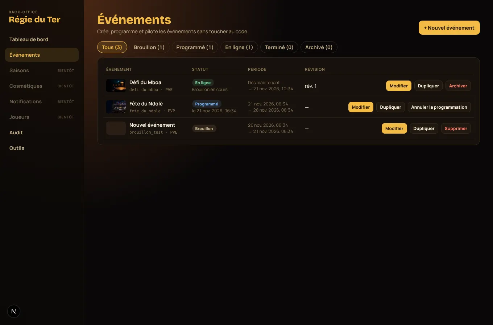
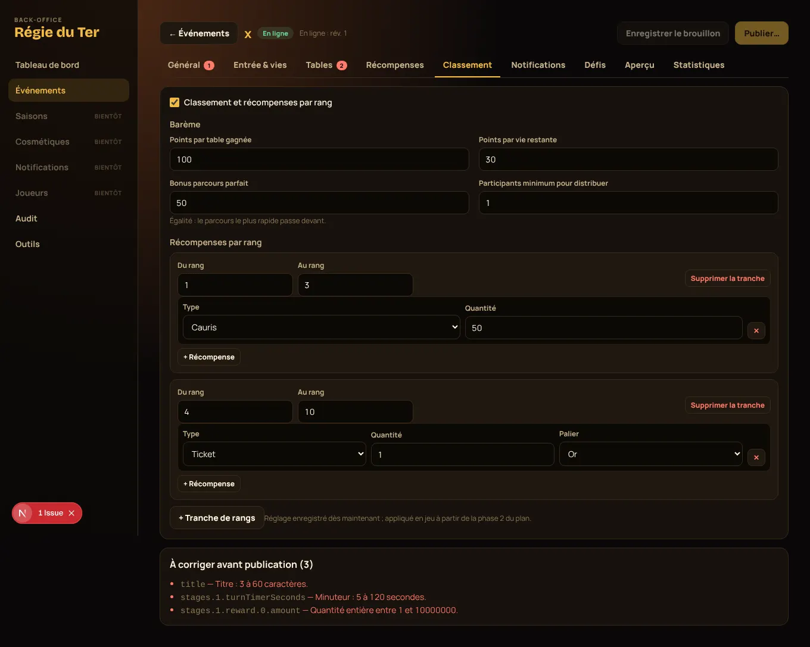
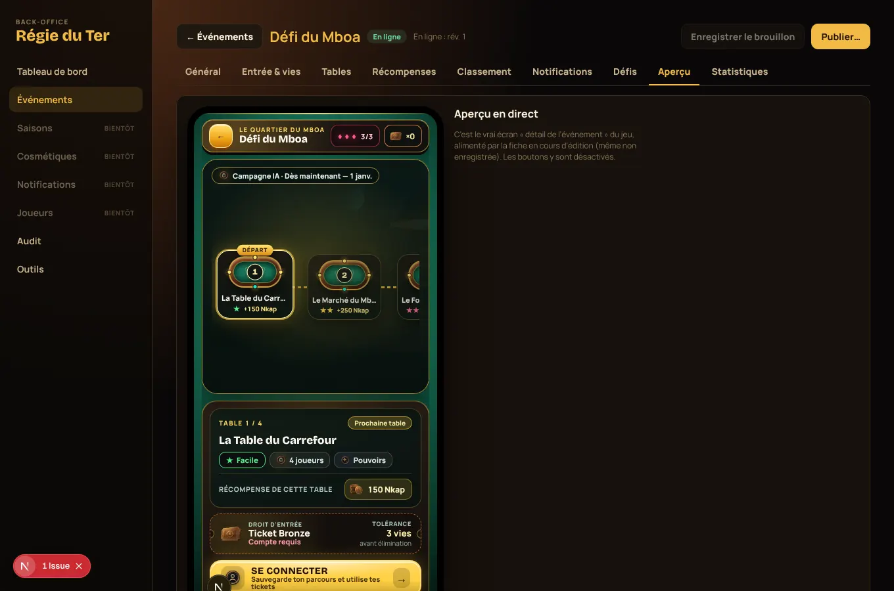

# Plan — Événements addictifs & pilotage 100 % admin

> Document de **plan et de suivi**. Il est mis à jour à chaque implémentation :
> cases cochées, statut de phase, journal en bas de page.
>
> Branches : `ccr-915a352f-mzjh26` (phase 0, plan) → `ccr-d50eb567-ocrmnv` (phase 1 →)

## Suivi global

| Phase | Contenu | Statut |
| --- | --- | --- |
| 0 | Socle déjà livré (retour parcours, animations, 1 ticket = 1 parcours) | ✅ Terminé |
| 1 | Fondations : modèle v2, validation, console admin événements, upload, stats | ✅ Code terminé — à valider en prod |
| 2 | Classement + récompenses par rang + compte à rebours | ⬜ À faire |
| 3 | Notifications programmées (campagnes) | ⬜ À faire |
| 4 | Sauver une vie, parcours parfait, modificateurs & boss | ⬜ À faire |
| 5 | Cosmétiques (récompenses exclusives) | ⬜ À faire |
| 6 | Saison (passe gratuit + premium XAF) | ⬜ À faire |
| 7 | Défis entre amis | ⬜ À faire |

Légende : ⬜ à faire · 🟡 en cours · ✅ terminé · ⛔ bloqué

---

## Décisions validées

| Sujet | Décision |
| --- | --- |
| Sauver une vie | Payé en **cauris** ; prix et nombre max configurables par événement (défaut proposé : 20 puis 40 cauris, 2 fois max, 10 min pour décider) |
| Saison premium | Payée en **XAF** via le flux de paiement existant (`createPaymentIntent` / `verifyStorePurchase`) |
| Images (événements, cosmétiques) | **Upload depuis l'admin**, stockées sur le VPS |
| Score de classement | **100** pts / table gagnée · **30** pts / vie restante · **50** pts bonus parfait · départage au temps (le plus rapide devant) — barème modifiable par événement |
| Défis entre amis | **Petite récompense** au gagnant, pas de mise entre joueurs |

---

## Principes d'architecture

1. **Zéro réglage en dur** : tout paramètre d'événement vit dans une fiche
   (`event_versions/{eventId}_v{rev}`) créée dans l'admin. `DEFAULT_EVENTS`
   ne sert plus qu'à amorcer une base vide (`seedLiveOps`).
2. **Trois couches**, toujours dans cet ordre :
   - `domain/` — types + règles pures (calcul de score, prix du rachat,
     distribution par rang, validation). **Testées** (`tests/`).
   - `functions/src/` — commandes serveur faisant autorité (transactions,
     idempotence `runIdempotent`, ledger), exposées par `server/src/routes.ts`.
   - Client (`components/`, `hooks/`) — affichage uniquement, lectures temps
     réel autorisées par `server/src/realtime/authz.ts`.
3. **Une seule validation** (`validateEventVersion`) partagée par l'éditeur
   admin (erreurs en direct) et le serveur (refus de publier une fiche invalide).
4. **Versionnage** : publier une modification crée une révision ; les parcours
   en cours gardent leur `versionSnapshot`. Le classement est rattaché à
   l'`eventId` (pas à la révision) et n'est donc pas remis à zéro.
5. **Admin sécurisé** : toute commande admin = `requireAdmin` + idempotence +
   entrée `admin_audit`.
6. **Déploiement** : back d'abord (`scripts/deploy-back.sh`), puis front.

---

## Phase 1 — Fondations (modèle v2 + console admin)

**Objectif** : créer, modifier, prévisualiser, programmer et publier n'importe
quel événement **sans toucher au code**.

### Modèle `EventVersion` v2 (`domain/events.ts`)

```ts
EventVersion {
  eventId, revision, published,
  // Général
  title, description, imageUrl, theme: { accent, label },
  mode: "pve" | "pvp", startsAt, endsAt,
  // Entrée & vies
  ticketTier, allowedLosses,
  revive: { enabled, maxPerRun, pricesCauris: number[], windowMinutes },   // phase 4
  // Tables
  stages: EventStage[],
  // Récompenses
  finalReward: Reward[],
  perfectRun: { reward: Reward[], badgeCosmeticId?: string },              // phase 4
  // Classement
  leaderboard: { enabled, pointsPerStage, pointsPerLifeLeft, perfectBonus,
                 minParticipants, rankRewards: { fromRank, toRank, reward: Reward[] }[] }, // phase 2
  // Notifications
  notifications: { id, trigger: "opening" | "before_end" | "at", offsetMinutes?, at?,
                   title, body, audience: "all" | "active_run" | "not_joined" }[],   // phase 3
  // Saison & défis
  seasonId?: string,                                                       // phase 6
  friendChallenges: { enabled, winnerReward: Reward[] },                   // phase 7
}

EventStage {
  id, order, title, difficulty, playerCount, stakeNkap,
  powersAllowed, crownsEnabled, reward, rewardRepeatable,
  modifiers: ("no_powers" | "double_stake" | "turn_timer")[],              // phase 4
  turnTimerSeconds?, boss?: { name, avatarUrl, botLevel },                 // phase 4
  seasonPoints,                                                            // phase 6
}
```

Les blocs des phases suivantes sont ajoutés **optionnels** dès la phase 1
(valeurs par défaut = désactivé), pour que l'éditeur ait sa structure finale.

**Implémenté** dans `domain/events.ts` (types) et `domain/eventConfig.ts`
(règles pures) :

| Fonction | Rôle |
| --- | --- |
| `normalizeEventVersion(raw)` | Complète n'importe quelle fiche (v1, partielle, JSON admin) avec les valeurs v2 par défaut ; trie les tables par `order` ; reprend `rankingRewardsEnabled` (v1) dans `leaderboard.enabled`. Idempotente. |
| `validateEventVersion(event)` | Renvoie la liste des erreurs `{ path, message }` (ex. `stages.0.reward.0.amount`) ; liste vide = publiable. Les blocs désactivés (rachat, classement, défis) ne sont pas vérifiés. |
| `eventLifecycle(event, now)` | `draft` · `scheduled` · `live` · `ended` · `archived` (filtres de la liste admin). |
| `blankEventVersion(id)` | Fiche vierge valide (début J+1, durée 7 j, 1 table). |

`theme` = `{ accent: "#rrggbb", label, tone? }`. `DEFAULT_EVENTS` porte
désormais `imageUrl` + `theme`. Les lectures (`joinEvent`, `useLiveOpsContent`)
passent par `normalizeEventVersion`. Tests : `tests/event-config.test.ts`.

### Tâches

- [x] Étendre `EventVersion` / `EventStage` + fonction `normalizeEventVersion()` (valeurs par défaut, compatibilité anciennes fiches)
- [x] `validateEventVersion()` dans `domain/` (dates cohérentes, ≥ 1 table, vies ≥ 1, récompenses valides, rangs sans chevauchement…) + tests
- [x] Commandes admin : `listAdminEvents`, `getAdminEvent`, `saveEventDraft`, `publishEventDraft` (maintenant ou programmé), `duplicateEvent`, `archiveEvent` — validation serveur + audit
- [x] Publication programmée : statut `scheduled` + job serveur (1 min) qui rend visible à l'heure choisie (`publishAt`)
- [x] **Upload d'images** : endpoint `POST /admin/upload` (admin uniquement, PNG/JPEG/WebP, ≤ 2 Mo, conversion WebP avec `sharp`, nom aléatoire) → fichier dans `UPLOAD_DIR` (ex. `/opt/njambo-uploads`) servi en `/uploads/…` par le serveur (cache long) ; config Nginx ajoutée à `docs/deploiement.md`
- [x] Script `server/scripts/set-admin.cjs` (attribue / retire / liste le custom claim `admin`)
- [x] Console `/admin` reconstruite : navigation latérale (Tableau de bord, Événements, Saisons, Cosmétiques, Notifications, Joueurs, Audit, Outils) — sections futures en « bientôt »
- [x] Liste des événements (filtres brouillon / programmé / en ligne / terminé / archivé)
- [x] Éditeur en onglets : Général · Entrée & vies · Tables (ajout, suppression, glisser-réordonner) · Récompenses · Classement · Notifications · Défis
- [x] Composant réutilisable `RewardPicker` (type → champs adaptés)
- [x] **Aperçu** : rend le vrai `EventDetailScreen` avec la fiche brouillon
- [x] Statistiques d'un événement : inscrits, actifs, éliminés, complétés, entonnoir par table — ✅ commande `getAdminEventStats` + onglet Statistiques (KPI + entonnoir)
- [x] Section Joueurs (minimale) : recherche, parcours d'un joueur, rendre un ticket, réinitialiser un parcours (audit)
- [x] Client : les écrans événements utilisent `imageUrl` / `theme` de la fiche (fini les tables `EVENT_ART` en dur) — `lib/eventArt.ts` (image distante = `unoptimized`, vignette -480 pour les assets locaux), `resolveEventTheme(event)` lit `event.theme` (accent hex → accent doux calculé), l'overlay de matchmaking prend le thème du `versionSnapshot`
- [x] `authz.ts` : lecture des nouvelles collections admin réservée aux admins (`event_drafts`, + règle `firestore.rules`)
- [x] Mise à jour `docs/deploiement.md` (UPLOAD_DIR, PUBLIC_BASE_URL, Nginx `/uploads`, `set-admin.cjs`)

**Critère de fin** : un admin crée un événement complet (image incluse), le
prévisualise, le programme ; il apparaît à l'heure dite chez les joueurs.

### Commandes admin — implémenté (`functions/src/eventAdminCommands.ts`)

Données :

| Collection | Contenu | Lecture |
| --- | --- | --- |
| `events/{eventId}` | Index public (`published`, `activeRevision`, titre, dates, image, thème) + suivi admin (`latestRevision`, `scheduledRevision`, `scheduledAt`, `archived`) | joueurs si `published` |
| `event_versions/{id}_v{rev}` | Révisions **publiées**, immuables | joueurs si `published` |
| `event_drafts/{eventId}` | Brouillon en cours (un par événement) : `{ version, baseRevision, updatedAt, updatedBy }` | admins |

| Commande | Effet |
| --- | --- |
| `listAdminEvents` | Tous les événements + brouillons, avec `lifecycle` (draft/scheduled/live/ended/archived) |
| `getAdminEvent { eventId }` | `active`, `draft`, `working` (ce que l'éditeur affiche) + `issues` |
| `saveEventDraft { event }` | Normalise et enregistre le brouillon **même incomplet** ; renvoie `issues`. Crée l'index (non publié) si nouvel événement |
| `publishEventDraft { eventId, publishAt? }` | Refuse si invalide (`EVENT_INVALID`, `details.issues`) ou déjà terminé ; crée la révision `latestRevision + 1` ; immédiat, ou programmé si `publishAt` futur |
| `cancelScheduledEvent { eventId }` | Annule une programmation |
| `duplicateEvent { eventId, newEventId }` | Copie en brouillon (refus si l'id existe) |
| `archiveEvent { eventId, archived }` | Retire / remet en ligne pour les joueurs |
| `discardEventDraft { eventId }` | Jette le brouillon (et l'index si jamais publié) |
| `getAdminEventStats { eventId }` | Parcours, joueurs, actifs, éliminés, complétés, abandons, entonnoir par table |

Job `promoteScheduledEventsImpl` : chaque minute (`server/src/jobs.ts`, et
`promoteScheduledEvents` côté Cloud Functions) — active la révision programmée
dont `scheduledAt` est passé (audit `uid: "system"`).

Les erreurs serveur transmettent désormais `details` (`server/src/httpError.ts`
→ `BackendError.details` côté client) pour afficher les erreurs de validation.

### Console admin — implémenté (`components/admin/`)

| Fichier | Rôle |
| --- | --- |
| `AdminConsole.tsx` | Coquille : contrôle du claim `admin`, navigation latérale, **Tableau de bord** (compteurs par statut, en ligne, à venir, fin < 48 h), **Audit** (100 dernières actions, temps réel), **Outils** (données de base, préversion, JSON brut pour offres/boosters/tables) |
| `EventsAdmin.tsx` | Liste filtrable ; actions Modifier, Dupliquer, Annuler la programmation, Supprimer le brouillon, Archiver / Désarchiver ; création avec choix de l'identifiant |
| `EventEditor.tsx` | Onglets Général · Entrée & vies · Tables · Récompenses · Classement · Notifications · Défis · Aperçu · Statistiques ; validation du domaine **en direct** (pastille d'erreurs par onglet + liste « à corriger ») ; « Publier… » bloqué tant qu'il reste une erreur ; dialogue maintenant / programmer ; alerte si on quitte sans enregistrer |
| `RewardPicker.tsx` | Liste de récompenses, champs selon le type (Nkap, cauris, ticket, énergie, livre, carte) |
| `ImageField.tsx` | Upload (→ WebP sur le VPS) ou choix dans la bibliothèque, ou chemin manuel |
| `EventPreviewHost.tsx` + `app/admin/apercu` | Le **vrai** `EventDetailScreen` (mêmes providers que le jeu) dans un iframe 390 px, alimenté par `postMessage` ; prop `previewEvent` : pas de parcours réel, actions désactivées |
| `adminApi.ts` / `adminUi.tsx` | Appels typés, upload, messages d'erreur en français ; badges de statut, dates |

Les réglages des phases suivantes (rachat, parcours parfait, classement,
notifications, défis, modificateurs, boss, points de saison) sont déjà
éditables et enregistrés ; l'éditeur indique la phase où ils prennent effet.

Vérifié dans Chromium (Playwright) : liste, onglets, erreurs par chemin,
bouton Publier désactivé si erreurs, aperçu réel, aucune barre de défilement
horizontale à 390 px. Captures : `docs/captures/admin-evenements/`.





### Section Joueurs — implémenté (`functions/src/playerAdminCommands.ts`, `components/admin/PlayersAdmin.tsx`)

| Commande | Effet |
| --- | --- |
| `adminSearchPlayers { query }` | Par e-mail (Firebase Auth), par uid, ou par début de nom (sensible à la casse) — 20 résultats max |
| `adminGetPlayer { uid }` | Profil, Nkap, cauris, couronnes, tickets, 50 derniers parcours (avec « partie en cours ») |
| `adminGrantTicket { uid, tier, amount ≤ 10, reason }` | Crédite des tickets ; **motif obligatoire** ; idempotent |
| `adminResetEventRun { runId, mode, reason }` | `restart` : table 1, toutes les vies, sans nouveau ticket ; `close` : termine le parcours. Refusé pendant une partie (`RUN_IN_MATCH`) |

Chaque écriture est consignée dans `admin_audit` avec le motif. Test :
`node server/scripts/smoke-player-admin.cjs` (Postgres jetable) — 11/11.

### Reste à faire pour valider la phase 1 (en production)

1. Déployer le back (`scripts/deploy-back.sh`) après avoir ajouté `UPLOAD_DIR`,
   `PUBLIC_BASE_URL` dans `server/.env` et le bloc Nginx `/uploads/` + `client_max_body_size`.
2. `node scripts/set-admin.cjs <ton e-mail>` puis se reconnecter.
3. Déployer le front, ouvrir `/admin` → créer un événement avec image,
   le prévisualiser, le **programmer** dans quelques minutes et vérifier
   qu'il apparaît chez un joueur à l'heure dite (critère de fin).

### Upload d'images — implémenté (`server/src/uploads.ts`)

- `POST /admin/upload?kind=event|boss|cosmetic|season`, en-tête
  `Authorization: Bearer <idToken admin>`, corps = fichier brut
  (`Content-Type` PNG/JPEG/WebP), **2 Mo max** (413 au-delà).
- Contrôle de la **signature binaire** (un faux PNG est refusé), ré-encodage
  WebP par `sharp` (qualité 82, 1600 px de large max, rotation EXIF appliquée,
  métadonnées retirées), nom aléatoire `UUID.webp`, jamais d'écrasement.
- Stockage `UPLOAD_DIR/<kind>/…`, servi en `GET /uploads/<kind>/…`
  (cache immuable 1 an ; en prod Nginx sert le dossier directement).
- Réponse `{ url, path, width, height, bytes }` ; `url` = `PUBLIC_BASE_URL + path`.
- Chaque upload est inscrit dans `admin_uploads` (bibliothèque, commande
  `listAdminUploads { kind? }`) et dans `admin_audit`.
- Vérifié de bout en bout (Express + sharp + Postgres) : 403 non-admin, type
  refusé, faux PNG refusé, `kind` invalide refusé, 413 > 2 Mo, redimension
  2400 → 1600 px, WebP servi avec cache immuable, pas de traversée de dossier.

Test d'intégration (Postgres réel, base **jetable**) :
`npm --prefix server run build && DATABASE_URL=… node server/scripts/smoke-event-admin.cjs`
— 20 vérifications : droits admin, brouillon invalide, refus de publication,
programmation/promotion, duplication, archivage, idempotence du double clic,
statistiques, audit.

---

## Phase 2 — Classement + récompenses par rang + compte à rebours

### Données
- `event_leaderboards/{eventId}/entries/{uid}` : `{ score, stagesWon, livesLeft, perfect, finishedAt, durationMs, name, emoji, updatedAt }`
- `event_versions/…` : `rankingSettledAt` (idempotence de la distribution)

### Tâches
- [ ] `domain/` : `scoreEventRun()` (barème de la fiche) + `rankRewardsFor(rank)` + tri/départage + tests
- [ ] Mise à jour du score **dans la même transaction** que le règlement de table (`matchCommands.ts`)
- [ ] Façade Postgres : requête de **comptage** (`count()`) pour calculer le rang d'un joueur
- [ ] Lecture : top 50 + « mon rang » (commande `getEventRank` ou requête autorisée)
- [ ] Job `settleEventRankings` (toutes les 5 min) : événements terminés non réglés → récompenses par rang dans les inventaires + ledger + notification in-app ; respecte `minParticipants`
- [ ] Client : onglet **Classement** sur le détail événement (podium, ma ligne épinglée, récompenses par rang)
- [ ] Client : **compte à rebours** (liste + détail + carte du menu), état « se termine bientôt » < 2 h
- [ ] Admin : onglet Classement de l'éditeur + vue classement en direct dans les stats
- [ ] Animation de résultat : points gagnés et rang qui monte dans l'overlay de conséquences

**Critère de fin** : à la fin d'un événement, chaque joueur classé reçoit
automatiquement la récompense de son rang, une seule fois.

---

## Phase 3 — Notifications programmées

### Données
- `notification_campaigns/{id}` : `{ eventId?, title, body, audience, sendAt, status: "scheduled"|"sending"|"sent"|"cancelled", stats: { targeted, sent, failed } }`
- `players/{uid}.notificationPrefs.events` (opt-out)

### Tâches
- [ ] À la publication d'un événement : création/maj des campagnes depuis `notifications[]` de la fiche (ouverture, X min avant la fin, date fixe)
- [ ] Job serveur (1 min) : campagnes dues → ciblage (`all` / `active_run` / `not_joined`) → push FCM (tokens existants) + `users/{uid}/notifications` ; envoi par lots, idempotent
- [ ] Nettoyage des tokens FCM invalides
- [ ] Section admin **Notifications** : campagnes libres (immédiates ou programmées), audience, aperçu, historique + stats
- [ ] Options joueur : interrupteur « Alertes d'événements »
- [ ] Clic sur la notification → ouvre directement le détail de l'événement

**Critère de fin** : une campagne programmée part à l'heure, une seule fois,
uniquement vers l'audience choisie, et respecte l'opt-out.

---

## Phase 4 — Sauver une vie · Parcours parfait · Modificateurs & boss

### Sauver une vie
- [ ] `domain/` : `revivePrice(revivesUsed, config)` + `canRevive(run, now, config)` + tests
- [ ] À l'élimination : `eliminatedAt` sur le run
- [ ] Commande `reviveEventRun` : run éliminé, dans la fenêtre, sous le max → débit cauris, `losses - 1`, statut jouable, `revivesUsed + 1`, ledger
- [ ] Overlay « Éliminé » : bouton « Continuer · X cauris » + minuteur ; animation de gemme qui se reforme
- [ ] Stats admin : rachats, cauris dépensés

### Parcours parfait
- [ ] À la complétion avec `losses === 0` : `perfectRun.reward` + badge cosmétique (phase 5) + `run.perfect = true`
- [ ] Overlay « Grand prix » : variante « Parcours parfait »
- [ ] Badge visible sur le profil (après phase 5)

### Modificateurs & boss
- [ ] Moteur des bots serveur : paramètre de **niveau** (aujourd'hui seulement côté local)
- [ ] `startMatch` applique `modifiers` (pouvoirs interdits, mise ×2, minuteur de tour) et le profil du boss (nom, avatar, niveau)
- [ ] Minuteur de tour côté serveur (coup automatique à expiration) si `turn_timer`
- [ ] Client : étiquettes de modificateurs sur les tables + présentation « Boss » à l'entrée de table
- [ ] Admin : édition des modificateurs et du boss par table (avatar via upload)

**Critère de fin** : un joueur éliminé peut racheter une vie en cauris dans
la limite fixée ; les modificateurs configurés s'appliquent réellement en partie.

---

## Phase 5 — Cosmétiques

### Données
- `cosmetics/{id}` : `{ type: "card_back" | "avatar_frame" | "badge" | "title", name, imageUrl, rarity, active }`
- `inventories/{uid}.cosmetics: string[]`
- `players/{uid}.equippedCosmetics: { cardBack?, avatarFrame?, badge?, title? }` (public)
- Nouveau type de récompense : `{ type: "cosmetic", cosmeticId }`

### Tâches
- [ ] `applyReward` gère `cosmetic` (doublon → compensation en cauris)
- [ ] Commande `equipCosmetic`
- [ ] Admin : catalogue cosmétiques (upload, rareté, activation)
- [ ] `RewardPicker` : choix d'un cosmétique
- [ ] Profil : onglet « Collection » + équipement
- [ ] Rendu : dos de carte à la table, cadre d'avatar et badge (table, profil, classement), titre sous le nom
- [ ] Animations de gain dans l'overlay de conséquences

**Critère de fin** : un cosmétique créé dans l'admin peut être gagné dans un
événement, équipé, et vu par les autres joueurs.

---

## Phase 6 — Saison (passe gratuit + premium XAF)

### Données
- `seasons/{id}` : `{ title, startsAt, endsAt, imageUrl, tiers: { points, freeReward, premiumReward }[], premiumPriceXaf }`
- `season_progress/{seasonId}_{uid}` : `{ points, claimedFree: number[], claimedPremium: number[], premium: boolean }`

### Tâches
- [ ] Points de saison crédités au règlement d'une table (`stage.seasonPoints`) — option : points pour les parties classiques
- [ ] Commande `claimSeasonTier` (gratuit / premium)
- [ ] Achat premium : offre `season_premium` dans le flux de paiement existant ; à `paid` → `premium = true` (paliers déjà atteints réclamables)
- [ ] ⚠️ **Dépendance** : les fournisseurs de paiement sont aujourd'hui **simulés** (`functions/src/payments/providers.ts`). Le premium XAF réel nécessite les adaptateurs MTN MoMo / Orange Money (hors de ce plan, à planifier)
- [ ] Écran **Saison** : piste de paliers, gratuit/premium, bouton d'achat
- [ ] Admin : éditeur de saison (dates, paliers, récompenses, prix XAF) + stats (joueurs, premium vendus)
- [ ] Fin de saison : paliers non réclamés perdus (ou réclamables X jours — à décider)

**Critère de fin** : jouer des tables d'événement fait monter la saison ;
l'achat premium (simulé) débloque les récompenses premium.

---

## Phase 7 — Défis entre amis

### Données
- `event_challenges/{id}` : `{ eventId, revision, fromUid, toUid, status: "pending"|"accepted"|"declined"|"finished"|"expired", fromRunId?, toRunId?, scores, winnerUid?, expiresAt }`

### Tâches
- [ ] Commandes `createEventChallenge`, `respondEventChallenge` (le défi lie le prochain parcours de chacun sur l'événement)
- [ ] Fin du défi quand les deux parcours sont terminés (ou expiration) → comparaison des scores (barème phase 2) → `winnerReward` + notifications
- [ ] Client : bouton « Défier un ami » sur le détail, liste des défis en cours, écran de résultat du duel
- [ ] Notifications in-app/push : défi reçu, défi terminé
- [ ] Admin : activation + récompense par événement ; stats défis

**Critère de fin** : deux amis s'affrontent sur le même événement et le
gagnant reçoit automatiquement sa récompense.

---

## Tests & qualité (toutes phases)

- Règles pures dans `domain/` couvertes par `vitest` (`tests/`).
- Commandes : idempotence (double clic = un seul effet), refus hors conditions.
- `npx tsc --noEmit` (front) + `tsc -p server` (back) + `eslint` sur les fichiers modifiés.
- Vérification visuelle (captures Playwright) des nouveaux écrans.
- Pré-existant, non lié : `tests/performance-config.test.ts` et `tests/authoritative-game-sync.test.ts` échouent déjà sur `master`.

---

## Journal

| Date | Phase | Changement |
| --- | --- | --- |
| 2026-11-20 | 0 | Retour au détail après partie/abandon ; overlay de conséquences (table validée, vie perdue, éliminé, grand prix) ; un ticket couvre tout le parcours (annulation, PvP, abandon corrigés). |
| 2026-11-20 | — | Plan créé ; décisions validées (cauris, premium XAF, upload admin, barème 100/30/50, petite récompense des défis). |
| 2026-11-20 | 1 | Modèle `EventVersion` v2 + `normalizeEventVersion` / `validateEventVersion` / `eventLifecycle` / `blankEventVersion` (`domain/eventConfig.ts`), 11 tests ; lectures serveur et client normalisées. |
| 2026-11-20 | 1 | Commandes admin événements (liste, détail, brouillon, publication immédiate/programmée, annulation, duplication, archivage, abandon de brouillon, stats) + job de promotion (1 min) + `event_drafts` réservé aux admins ; test d'intégration Postgres 20/20. |
| 2026-11-20 | 1 | Upload d'images admin (`/admin/upload`, sharp → WebP, `/uploads` cache immuable, bibliothèque `admin_uploads`) ; script `set-admin.cjs` ; guide de déploiement mis à jour (UPLOAD_DIR, PUBLIC_BASE_URL, Nginx). |
| 2026-11-20 | 1 | Écrans joueurs (liste, détail, carte du menu, matchmaking) : image et thème lus depuis la fiche ; suppression de `EVENT_ART` / `EVENT_THUMBS`. |
| 2026-11-20 | 1 | Console `/admin` reconstruite : tableau de bord, liste filtrable, éditeur en onglets avec validation en direct, `RewardPicker`, champ image (upload + bibliothèque), aperçu réel dans un iframe, statistiques, audit temps réel, outils historiques. |
| 2026-11-20 | 1 | Section Joueurs (recherche, soldes, parcours, tickets offerts avec motif, réinitialiser/clôturer un parcours) ; test Postgres 11/11. **Phase 1 : code terminé**, validation en production à faire. |
